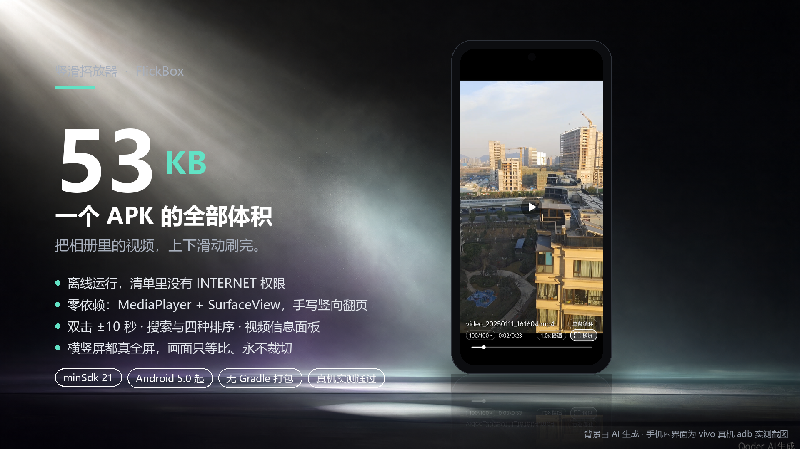
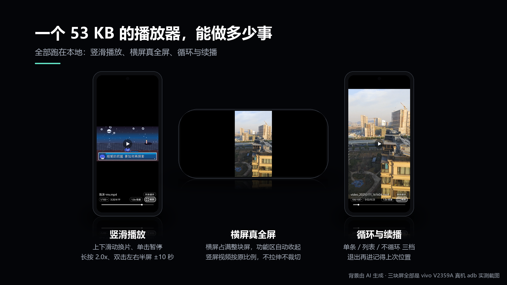

# 竖滑播放器 FlickBox



**手机相册里已经有的视频，用上下滑动的方式刷完。**

一个 53 KB 的安卓 APK。不联网、不装任何第三方库，直接读本机媒体库里的视频，用仿抖音的上下滑动手感来刷。

## 它有什么

| 亮点 | 说明 |
| --- | --- |
| 体积 | `dist/FlickBox.apk` = **53,720 字节**，比一张手机照片还小 |
| 离线 | 清单里没有 `INTERNET` 权限，代码里没有任何网络调用 |
| 零依赖 | 只有系统 `MediaPlayer` + `SurfaceView`，无 AndroidX、无 RecyclerView、无 XML 布局、无 Compose |
| 画面 | 一律按原比例完整显示，**永不裁切、拉伸、放大**，字幕和水印不会被切掉 |
| 手势 | 上下滑换片、单击暂停、长按 2 倍速、双击左右半屏 ±10 秒 |
| 选片 | 底部面板：缩略图列表 + 按片名/目录搜索 + 时间/名称/大小/目录四种排序 |
| 记忆 | 每条视频的进度、上次看到哪一条、倍速、循环档位、排序方式都会存下来 |

## 装上就能用

1. 把 `dist/FlickBox.apk` 传到手机安装（debug 签名，需要在系统里允许「安装未知来源应用」）。
2. 首次启动允许「读取视频」权限。
3. 上下滑。

用 adb 的话：

```powershell
adb install -r dist\FlickBox.apk
```

支持 Android 5.0（minSdk 21）及以上；倍速播放需要 Android 6.0 以上，更低版本照常播放。

## 手势

| 操作 | 行为 |
| --- | --- |
| 上下滑动 | 上一个 / 下一个视频，带惯性与回弹 |
| 单击画面 | 暂停 / 继续（为了给双击留判断窗口，约晚 0.3 秒生效） |
| 双击左半 / 右半 | 后退 / 快进 10 秒，侧边亮出提示条 |
| 长按画面 | 临时 2.0x，松手恢复 |
| 拖动 / 点按底部细线 | 精确定位 / 直接跳位；在细线上竖向滑仍会换视频 |
| 点「N/总数 ▾」 | 滑出选片面板，点一条直接播；点排序 tab 就地换序，面板不收起 |
| 点「信息」 | 这条视频的分辨率、码率、编码、帧率、路径、媒体库 ID 等 |
| 点「横屏」 | 真全屏横屏，竖屏视频按原比例居中不拉伸 |
| 点「顺序播放」chip | 顺序播放 → 单条循环 → 列表循环 |

播放中（横屏竖屏都一样）整条功能区自动收起，画面独占全屏；点一下暂停才浮回来。切到别的软件再回来画面照常，不会只剩声音。



## 为什么能压到 53 KB

- 全程只有一个 `MediaPlayer` 实例，换页时 `reset()` 复用，不创建第二个播放器。
- 竖向翻页是自己写的三槽环形容器（`PagerView`）：屏幕上永远只有 3 页，滑动过程只搬运位图，与解码无关，低配机也不掉帧。
- 所有控件（进度线、播放/暂停图标、横屏按钮、循环 chip、选片面板、信息面板）都是 `onDraw` 或代码搭出来的，工程里没有一张 UI 图片、没有一个 XML。
- 打包不经过 Gradle：`aapt2` + `kotlinc` + **R8** 命令行直出，R8 把 `kotlin-stdlib` 裁到只剩真正用到的那几个类。

## 自己构建

不需要 Android Studio，也不需要 Gradle。

```powershell
powershell -NoProfile -ExecutionPolicy Bypass -File tools\setup_env.ps1   # 一次性装工具链，约 450 MB
powershell -NoProfile -ExecutionPolicy Bypass -File tools\build_apk.ps1   # -> dist\FlickBox.apk
```

`setup_env.ps1` 装 Temurin JDK 17、Kotlin 2.1.0 编译器、Android cmdline-tools、`platforms;android-34`、`build-tools;34.0.0`，默认落在 `D:\CodeDevelop\Env`，可重复执行，路径不同时用 `-EnvRoot` 覆盖。构建产物是签名对齐好的 debug 包，控制台会打印体积和 `aapt2 dump badging` 摘要。

## 目录结构

```
AndroidManifest.xml           清单（无 INTERNET 权限）
r8.pro                        R8 裁剪规则
res/drawable/ic_launcher.png  启动图标（380 字节）
src/com/pd/player/
  MainActivity.kt             组装三层界面、权限、各类存档、旋转适配
  PagerView.kt                竖向翻页容器（拖动/惯性/吸附/3 槽复用 + 单击与双击识别）
  PageView.kt                 单页封面（异步取缩略图）
  Overlay.kt                  底部控制条（播放中整条收起）
  Controls.kt                 自绘控件：细进度线、播放/暂停徽标、横屏按钮
  Picker.kt                   选片面板与视频信息面板
  PlayerCtl.kt                MediaPlayer 封装（单实例、变速、进度、Surface 重绑）
  VideoRepo.kt                MediaStore 扫描 + 排序 + 元数据探测 + 缩略图缓存
tools/                        打包、装环境、生成图标与宣传图的脚本
promo/                        宣传图三张
docs/verification.md          逐轮真机实测采样、实现细节与踩过的坑
```
